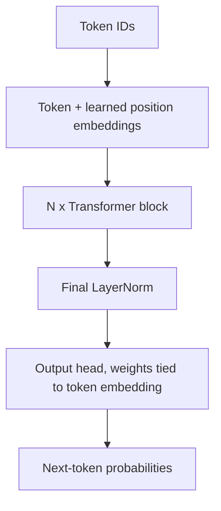

# EfficientGPT: GQA + SwiGLU in a small GPT

A small GPT-style language model, built and trained from scratch in PyTorch, used to test two architecture changes that make Transformers cheaper to run:

- **Grouped-Query Attention (GQA)**: several query heads share one key/value head, so the KV cache used during text generation is smaller.
- **SwiGLU**: a gated feed-forward layer that replaces the usual GELU feed-forward layer.

Four models (MHA/GQA x GELU/SwiGLU) are trained with identical data, seed and settings, then compared on validation loss, perplexity, KV-cache memory, generation speed, parameter count and training time.

> This project is **pre-training from scratch**. There is no fine-tuning stage.

## Key results

50M-parameter models, 50M training tokens each, one seed, trained on a free Colab T4 GPU.

| Config | Attention | Feed-forward | Params | Val loss | Perplexity | Train time |
|---|---|---|---|---|---|---|
| MHA + SwiGLU | MHA | SwiGLU | 51.7M | **2.5794** | **13.19** | 30.1 min |
| GQA + SwiGLU (hybrid) | GQA | SwiGLU | 48.6M | 2.5865 | 13.28 | 31.6 min |
| GQA + GELU | GQA | GELU | 48.1M | 2.6334 | 13.92 | 27.6 min |
| MHA + GELU (baseline) | MHA | GELU | 51.2M | 2.6394 | 14.00 | 28.6 min |


- **SwiGLU improved quality.** Validation loss was 0.047-0.060 lower than GELU with both attention types, at every evaluation point.
- **GQA kept quality and cut the KV cache 4x.** Its loss differed from MHA by under 0.01 (slightly better with GELU, slightly worse with SwiGLU), which a single seed cannot separate from noise.
- **The hybrid is the best trade-off.** Perplexity fell from 14.00 to 13.28 (about 5%) against the baseline, with 5% fewer parameters and a quarter of the KV cache.
- **GQA did not speed up generation in this implementation.** See [Inference benchmark](#inference-benchmark).

## Contents

- [Models compared](#models-compared)
- [Architecture](#architecture)
- [Dataset](#dataset)
- [Quick start](#quick-start)
- [Training settings](#training-settings)
- [Inference benchmark](#inference-benchmark)
- [Limitations](#limitations)
- [Future work](#future-work)
- [Repository layout](#repository-layout)
- [References](#references)

## Models compared

| Config | Attention | Feed-forward |
|---|---|---|
| Baseline GPT | Multi-head attention (MHA) | GELU, hidden size 4 x width |
| GPT + GQA | Grouped-query attention | GELU |
| GPT + SwiGLU | MHA | SwiGLU, hidden size about 8/3 x width |
| Hybrid EfficientGPT | Grouped-query attention | SwiGLU |

Switch them with `--attn {mha,gqa}` and `--ffn {gelu,swiglu}`.

## Architecture

A GPT-2 style decoder-only Transformer:



Each block (pre-LayerNorm) is:

```
x = x + Attention(LayerNorm(x))      # MHA or GQA, causal
x = x + FeedForward(LayerNorm(x))    # GELU or SwiGLU
```

- **Layout:** learned position embeddings, a final LayerNorm, output head tied to the token embedding. Linear layers have no bias and there is no dropout.
- **Initialisation:** weights ~ Normal(0, 0.02); each block's output projections are scaled by 1/sqrt(2 x layers).
- **MHA vs GQA:** the query projection gives all heads. The key/value projection gives one KV head per query head (MHA) or fewer (GQA). By default GQA uses a quarter of the query heads as KV heads: 2 at 50M (4 query heads share each) and 4 at 355M. Shared heads are repeated to full size before PyTorch's causal scaled-dot-product attention. The KV cache stores only the KV heads, which is where the memory saving comes from.
- **GELU vs SwiGLU:** the GELU layer is two matrices (width -> 4 x width -> width). SwiGLU is `down(silu(gate(x)) * up(x))` with three matrices. Its hidden size is about 8/3 x width rounded up to a multiple of 64 (1,408 at 50M), which keeps the parameter count close to the GELU layer.
- **KV-cache size** per sequence: `2 x layers x KV heads x head size x context x bytes`.

### Model sizes

| Size | Layers | Width | Heads | Context | Peak LR | Used for |
|---|---|---|---|---|---|---|
| `tiny` | 2 | 64 | 4 | 64 | 1e-3 | smoke tests |
| `30m` | 6 | 384 | 6 | 512 | 6e-4 | quick runs |
| `50m` | 8 | 512 | 8 | 512 | 6e-4 | **reported experiment** |
| `355m` | 24 | 1024 | 16 | 1024 | 3e-4 | optional larger run (GPT-2 medium scale) |

Parameter counts (millions). 50M numbers are from the trained models; 355M numbers are computed from the code.

| Config | 50M | 355M |
|---|---|---|
| MHA + GELU | 51.2 | 354.7 |
| GQA + GELU | 48.1 | 316.9 |
| MHA + SwiGLU | 51.7 | 356.2 |
| GQA + SwiGLU | 48.6 | 318.5 |

GQA removes about 3M parameters at 50M because the key/value projections shrink, so the comparison is **not** at equal parameter count.

## Dataset

[nampdn-ai/tiny-webtext](https://huggingface.co/datasets/nampdn-ai/tiny-webtext) on Hugging Face: about 2.32M rows of web text (about 1.26 GB of parquet files, MIT license). The dataset page asks you to log in and accept its terms before downloading.

`prepare.py`:

- streams the dataset, so it is never fully loaded into memory;
- uses the `text` column if present, otherwise picks the longest string column (override with `--text_col`);
- tokenizes with the GPT-2 byte-pair encoding (`tiktoken`) and appends an end-of-text token after each document; the model vocabulary is padded from 50,257 to 50,304;
- writes 16-bit token files `train.bin` and `val.bin`;
- sends every 200th document to validation (about 0.5%), so all four configs share exactly the same validation text.

Training batches are random 512-token windows from `train.bin`.

## Quick start

### Option A: Google Colab (easiest)

1. Open `notebooks/EfficientGPT_Colab.ipynb` in Colab (File -> Upload notebook) and set the runtime to a **T4 GPU**.
2. Run the cells top to bottom. The notebook writes all the code files itself, mounts Google Drive, prepares the data (it asks for a Hugging Face token, which is not stored), runs a smoke test, trains the four configs, then prints results, plots curves, runs the benchmark and generates text.
3. If Colab disconnects, reconnect and re-run the same cells: finished runs are skipped and unfinished ones resume from their last checkpoint.

The default settings (50M model, 50M tokens per config) train at about 32,000 tokens/s on a T4, so each config takes roughly 30 minutes.

### Option B: your own machine

```bash
git clone <this repo> && cd efficientgpt
pip install torch            # pick the build that matches your GPU: https://pytorch.org
pip install -r requirements.txt
huggingface-cli login        # needed once for the gated dataset
python check_gpu.py

# 1. data (run once)
python prepare.py --out data --tokens 60000000

# 2. smoke test (about a minute)
python efficientgpt.py --size tiny --data data --out_root test_runs --tokens 200000 --micro_bs 4 --accum 2 --eval_every 20 --eval_iters 5

# 3. train one config (repeat for the other three)
python efficientgpt.py --size 50m --attn gqa --ffn swiglu --data data --out_root runs \
    --micro_bs 8 --accum 8 --tokens 50000000 --eval_every 250 --ckpt_every 250 --eval_iters 50

# 4. results
python plot.py --runs runs --out results/val_loss.png
python bench.py --size 50m --out results/bench.csv --ctxs 256,512 --batches 1,4
python generate.py --ckpt runs/50m_gqa2_swiglu_s1337/final.pt --prompt "The future of AI" --tokens 100
```

Run folders are named `<size>_<attn><kv heads>_<ffn>_s<seed>`, for example `50m_mha_gelu_s1337` and `50m_gqa2_swiglu_s1337`. Re-running a training command resumes from `runs/<run>/ckpt.pt`.

Lower `--micro_bs` if you run out of GPU memory. Training the 355M model on a 4 GB GPU is possible with `--grad_ckpt --offload_opt`; see [docs/PC_SETUP.md](docs/PC_SETUP.md) and `run_355m.bat` / `run_all_355m.bat` (Windows).

## Training settings

Identical for all four configs:

| Setting | Value |
|---|---|
| Tokens per run | 50M (1,525 steps) |
| Tokens per step | 32,768 (batch 8 x 8 accumulation steps x 512) |
| Optimizer | AdamW, betas 0.9 / 0.95 |
| Peak learning rate | 6e-4 |
| Schedule | 100 warmup steps, then cosine decay to 10% of peak |
| Weight decay | 0.1 on weight matrices, 0 on biases and norms |
| Gradient clipping | 1.0 |
| Precision | fp16 mixed precision with loss scaling (bf16 on newer GPUs, fp32 on Pascal and older) |
| Seed | 1337 |
| Evaluation | every 250 steps on 50 fixed validation batches (about 205k tokens), identical for every run |
| Checkpoints | every 250 steps, saved atomically, automatic resume |

## Inference benchmark

`bench.py` measures KV-cache size and decoding speed with random weights (full data in [`results/bench.csv`](results/bench.csv)). Batch 4, context 512:

| Config | KV cache (MiB) | Tokens/s |
|---|---|---|
| MHA + GELU | 32.0 | 1,023.1 |
| GQA + GELU | 8.0 | 940.5 |
| MHA + SwiGLU | 32.0 | 1,036.1 |
| GQA + SwiGLU | 8.0 | 905.3 |

- The KV cache is exactly **4x smaller** with GQA at every batch size and context length tested, and the measured size matches the formula.
- GQA was **7-13% slower** at batch 4. The implementation repeats the shared K/V heads to full size before attention, so only the stored cache shrinks, not the compute. A 50M model at short context is also limited by per-token overhead rather than memory bandwidth, so GQA's bandwidth advantage does not show.
- Batch-1 numbers are noisy, and the first benchmark row includes GPU warm-up.

## Limitations

- **One seed.** Only the SwiGLU gain is clearly larger than run-to-run noise. The GQA-versus-MHA differences are within it.
- **Not equal size.** The GQA models have about 3M fewer parameters.
- **Small scale.** 50M parameters on 50M tokens gives perplexity around 13 and incoherent generated text; conclusions may not transfer to larger models.
- **Short training.** Losses were still falling at the end, and the SwiGLU gap narrowed over training (about 0.09 at step 250, about 0.06 at the end).
- **Speed test.** The attention implementation copies shared K/V heads, which hides GQA's compute saving.

## Future work

1. Run more seeds per config to add error bars.
2. Use PyTorch's built-in grouped-query attention option so K/V heads are not copied, then re-run the speed benchmark.
3. Benchmark the 355M size at larger batches and longer contexts, where the cache dominates.
4. Train on more tokens to see whether the SwiGLU gap keeps narrowing.
5. Compare at matched parameter counts by widening the GQA models.
6. Sweep the number of KV heads (1, 2, 4, 8) to find where quality starts to drop.
7. Add a simple text-generation interface to demo the models.

## Repository layout

```
efficientgpt.py        model (MHA/GQA, GELU/SwiGLU) + training loop with auto-resume
prepare.py             downloads and tokenizes the dataset into train.bin / val.bin
bench.py               KV-cache memory and decode-speed benchmark for the 4 configs
generate.py            text generation from a trained checkpoint (--chat for interactive)
plot.py                validation-loss curves from runs/*/log.csv
check_gpu.py           checks PyTorch, CUDA and GPU speed/memory
run_355m.bat           Windows launcher for one 355M run (offload + checkpointing)
run_all_355m.bat       Windows launcher for all four 355M runs
requirements.txt       Python dependencies (install PyTorch separately)
notebooks/             self-contained Colab notebook
results/               val_loss.png, training_summary.csv, bench.csv
docs/PC_SETUP.md       Windows setup guide for local / low-memory GPUs
```

## References

- Ainslie et al., *GQA: Training Generalized Multi-Query Transformer Models from Multi-Head Checkpoints*, 2023 (arXiv:2305.13245).
- Shazeer, *GLU Variants Improve Transformer*, 2020 (arXiv:2002.05202).
- Radford et al., *Language Models are Unsupervised Multitask Learners* (GPT-2), 2019.
- Dataset: [nampdn-ai/tiny-webtext](https://huggingface.co/datasets/nampdn-ai/tiny-webtext).
